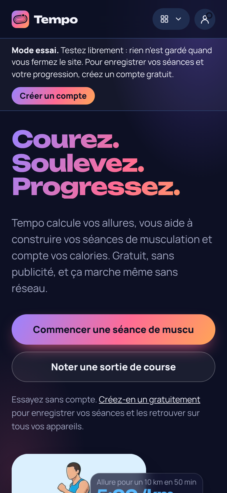
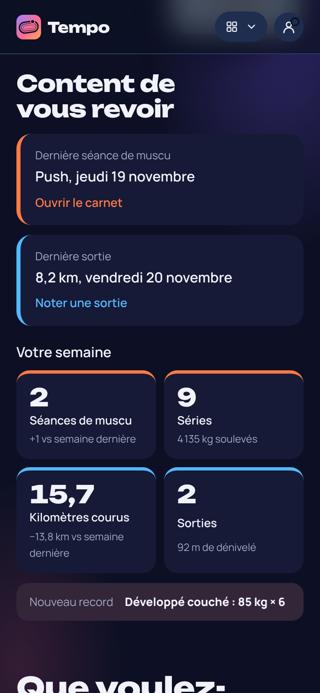
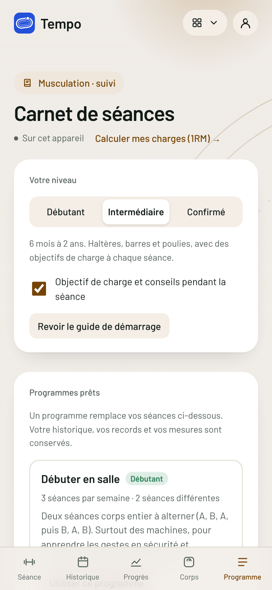
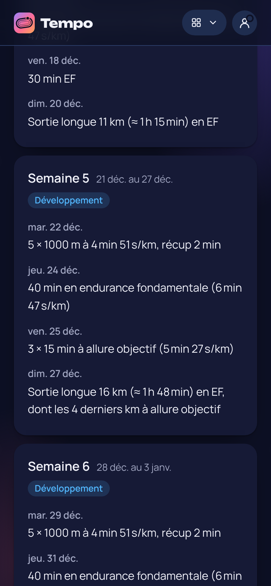
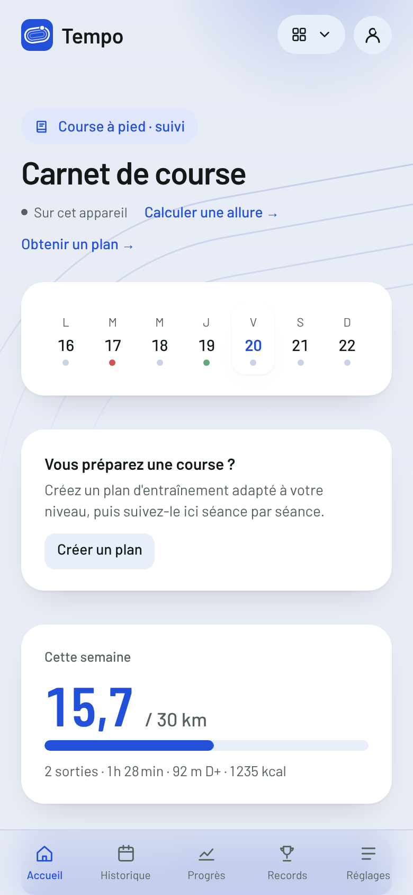
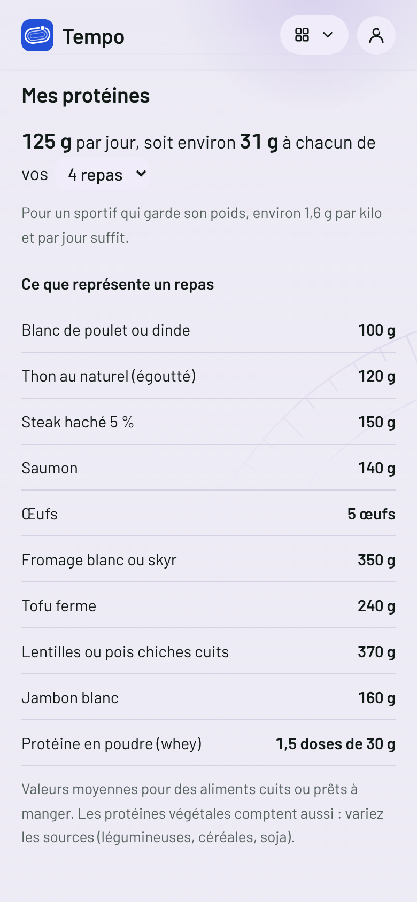

# Tempo

**Carnet d'entraînement pour la musculation, la course à pied et la santé, du débutant au confirmé.**

Site en ligne : **https://tempo-2er.pages.dev**

Projet personnel d'**Eugène Guenet**, étudiant en 1re année du cycle ingénieur en mécatronique à l'INSA Hauts-de-France. Je l'ai d'abord créé pour moi, pour retrouver mes séances et mes charges à la musculation, puis je l'ai ouvert à tous.
[LinkedIn](https://www.linkedin.com/in/eug%C3%A8ne-guenet-7b1296313)

<p>
  
  
  
  
  
  
</p>

## Fonctionnalités

**Musculation**
- Carnet de séances : charge et répétitions de chaque série, minuteur de repos, records, courbes de progression par exercice.
- 172 exercices avec fiche, carte des muscles travaillés et consignes en français.
- Adapté au niveau : guide de démarrage, 5 programmes prêts, séances proposées selon le type de séance et le niveau.
- Coach de progression : objectif de charge à chaque séance (surcharge progressive), séries d'échauffement calculées, disques à mettre sur la barre, alerte quand un exercice stagne.
- Lexique : chaque terme technique s'explique d'un toucher.

**Course à pied**
- Calculateur d'allure et prédiction de temps.
- Plans d'entraînement datés du 5 km au marathon et au trail, reliés au carnet : séance du jour, séances cochées, taux de réalisation.
- Import de sorties GPX (Strava, Garmin, Coros…) avec tracé du parcours.

**Autres sports et charge d'entraînement**
- Carnet multisport : rugby (entraînement ou match, minutes jouées), natation (distance, nage, allure aux 100 m), vélo et randonnée (import GPX), sports de combat, raquettes…
- Charge d'entraînement globale (méthode session-RPE : durée × effort ressenti) qui additionne musculation, course et autres sports.
- Rapport de charge aiguë / chronique (7 jours / 28 jours) avec alerte quand la charge monte trop vite, principal facteur de blessure.

**Découverte**
- Mode essai sans compte et bouton « Voir un exemple » : 12 semaines de carnets fictifs (musculation, rugby, course) pour tout explorer en un clic, jamais copiés dans un compte.

**Santé et partage**
- Zones cardiaques, besoins caloriques, objectif de protéines avec équivalents en aliments.
- Bilan de la semaine sur l'accueil.
- Partage d'une séance ou d'une sortie sous forme d'image.

## Choix techniques

| Sujet | Choix |
| --- | --- |
| Front-end | HTML, CSS et JavaScript sans framework ni étape de compilation |
| Application installable | Progressive Web App : manifeste et service worker (réseau d'abord pour les pages, cache pour le reste), fonctionne hors connexion |
| Sans compte | Mode essai : `sessionStorage`, rien n'est gardé après la visite (appareil partagé sans risque) |
| Comptes | Firebase Authentication : e-mail et mot de passe, ou connexion avec Google |
| Synchronisation | Firestore, un document par clé dans `users/{uid}/kv`. Les carnets sont découpés par mois pour rester loin de la limite de 1 Mo par document. Chaque écriture passe par une transaction qui relit le serveur et fusionne les séances : deux appareils peuvent enregistrer en même temps sans rien perdre. |
| Sécurité | Règles Firestore : chaque utilisateur ne lit et n'écrit que ses données, avec validation du format (`firestore.rules`) |
| Graphiques et images | SVG générés à la main, image de partage dessinée en Canvas |
| Hébergement | Cloudflare Pages, déploiement continu à chaque `git push`, version du service worker estampillée au build (`scripts/build.sh`) |
| Qualité | Tests de bout en bout avec Playwright (parcours débutant et confirmé, synchronisation entre deux appareils simulés), audits Lighthouse : 100 en accessibilité, bonnes pratiques et SEO, 95 à 100 en performance |

## Organisation du code

| Fichier | Rôle |
| --- | --- |
| `site/store.js` | Stockage local, comptes, synchronisation découpée par mois et fusion |
| `site/carnet.html` | Carnet de musculation (interface et logique) |
| `site/muscu-guide.js` | Niveaux, programmes, séances proposées, objectif de charge, échauffement, stagnation, lexique |
| `site/exercices.js` | Bibliothèque des 172 exercices |
| `site/illustrations.js` | Cartes anatomiques des muscles (SVG) |
| `site/journal.js` | Carnet de course et plan suivi |
| `site/multisport.js` | Carnet multisport |
| `site/charge.js` | Sports, calories et charge d'entraînement (session-RPE, rapport aigu / chronique) |
| `site/gpx.js` | Lecture des fichiers GPX et tracé du parcours |
| `site/app.js` | Calculateurs : allure, plan, zones, charges, calories, protéines |
| `site/share.js` | Image de partage (Canvas) |
| `site/sw.js` | Service worker |

## Lancer en local

```sh
cd site && python3 -m http.server 8000
```

Puis ouvrir http://localhost:8000.

## Contenus non inclus dans ce dépôt

Les illustrations des exercices et leurs consignes d'origine proviennent de [Exercise data by RepDB (repdb.co)](https://repdb.co). Leur licence interdit de les redistribuer : `site/img/ex/` et `site/guides.js` sont donc absents de ce dépôt public. Le site fonctionne sans eux (les fiches d'exercices s'affichent alors sans photos ni consignes pas à pas).

## Licence

© Eugène Guenet. Code publié pour consultation : tous droits réservés. Polices Barlow et Barlow Condensed sous licence SIL Open Font License (`site/fonts/OFL.txt`).
